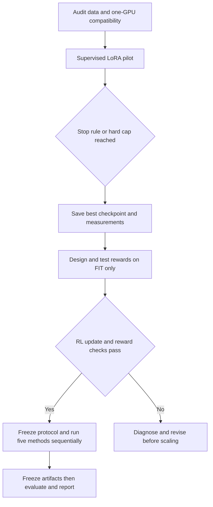
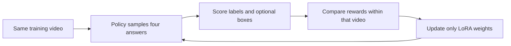

> Historical proposal. Current two-Ada execution authorization and measured status
> are in [AMENDMENTS.md](AMENDMENTS.md) and [EXECUTION.md](EXECUTION.md).

# Firearm video post-training: one-GPU controlled study

Prepared 2026-10-26, America/New_York. This is an execution handoff and proposed protocol, not a claim that new training has started.

## 1. User intent and authorization

The user approved a controlled comparison of (1) verbalized question learning, (2) LoRA supervised fine-tuning, (3) LoRA + outcome GRPO, (4) LoRA supervised fine-tuning with grounding, and (5) LoRA + grounded GRPO. They want one GPU, supervised training first with explicit stopping criteria, followed by designing and running RL using the measured feasibility results. They requested a complete handoff for a new Codex chat.

Implement the environment, data pipeline, trainers, reward environment, stopping callbacks, evaluation and report in the next chat. Ordinary implementation, setup and bounded pilots are within the requested scope. Do not ask again about routine reversible choices. Material changes to supervision, split, backbone across arms, GPU count or expanded resource ceilings require discussing the concrete change. Do not reinterpret this as permission to interrupt existing experiments, push, merge or publish.

The numerical settings below are proposed defaults, not prior empirical findings. Freeze them in a preregistration before comparative runs; record any amendment and its reason. No new environment or training was launched while preparing this document.

## 2. Current state and locations

- Mac repository: `/Users/shrid/Documents/research/VERA-package`.
- Branch at plan start: `experiment/firearm-package`, clean at `55b1df6`; unpushed. A later documentation commit may contain this handoff. Inspect current status before editing.
- Connection: `ssh -o BatchMode=yes sp2117@oz.gccis.rit.edu`; there is no `oz` SSH alias. Network access may require the app's network permission.
- Existing run checkout: `/local/datasets/sp2117/firearm_visilab/code/VERA-package-runs`.
- Existing package outputs: `/local/datasets/sp2117/firearm_visilab/package`.
- Existing train/validation JSON and audited boxes: `/local/datasets/sp2117/firearm_visilab/training1/data`.
- Existing frames: `/local/datasets/sp2117/firearm_visilab/training1/frames`.
- Codebook: `studies/firearm_training/codebook.json`; prompt files in `studies/firearm_training/prompts/`.
- Published revisions and local model paths: `studies/firearm_package/package.json`. Reuse those weights rather than redownloading.
- Existing job launcher: `/home/stu11/s5/sp2117/vera_research/setup/scripts/launch.sh`.

Read `studies/firearm_package/HANDOFF.md` and `DEVIATIONS.md` before touching the prior work. Its stopped attempts are preserved; never include `package/diagnostics/` in analysis. The remote 38B pipeline can append documentation to DEVIATIONS.md; preserve and bring back that text rather than discarding a dirty checkout.

### Live snapshot at 2026-10-26 21:42 ET

- Ada 4: InternVL3.5-8B detector thinking arm, 282/300 successful records; other detector arms in that job had completed.
- Ada 5: InternVL3.5 thinking recognition, 68/302 records; the other seven recognition arms completed.
- Ada 6: Qwen detector job completed successfully; GPU had 2 MiB used and 0% utilization.
- Six A16s: 38B detector pipeline; off arm 115/300 records. Its probes had completed, including thinking on.
- Ada 7 remains reserved/free under the existing instruction.
- Existing gate job is waiting for all Phase 1 arms. Zero failed call records in the snapshot; this does not establish model accuracy.

These are historical observations, not reservations. Recheck idle status and compute processes immediately before launch.

## 3. Resource and isolation contract

**Use exactly one GPU for the NEW study at a time, including rollout generation, reference evaluation, training and inference.** Sequential runs and seeds, no distributed trainer, no separate GPU inference server, no A16 sharding. Existing unrelated jobs may continue on their own GPUs.

Prefer Ada 6, UUID `GPU-2931eba2-9a4d-61da-6bd1-e75692edad03`, only if still idle. Require no compute processes, <500 MiB memory used and <5% utilization. Pin its full UUID in CUDA_VISIBLE_DEVICES. If unavailable, wait or use another released Ada 4–6 after checking ownership; keep Ada 7 free. Never kill someone else's job or an existing study to free a device.

Create an isolated checkout/branch and new output root, e.g.:

- suggested local branch: `experiment/firearm-posttraining` (verify it does not already exist);
- suggested oz checkout: `.../code/VERA-firearm-posttraining`;
- outputs: `/local/datasets/sp2117/firearm_visilab/posttraining1`;
- new environment: `/local/datasets/sp2117/envs/firearm-posttrain`.

The existing inference loader is not a training implementation: its chat/generate wrappers and inference_mode must not be reused for gradient training. Build a training-compatible forward path. Preserve original code and environments.

Proposed hard allocation: 48 GPU-hours total for the new study, counted as wall time while occupying the GPU, including pilots, validation and final inference. Reserve 3 hours for feasibility/pilots, up to 2.5 hours per method/seed including warm-up and checks (15 × 2.5 = 37.5 hours), and 7.5 hours for remaining evaluation. These are ceilings, not targets or runtime promises. Record throughput and forecast completion before the sweep. At the first exhausted cap, save state and report unfinished work; do not silently extend it or claim completion. A time-limited result must be labeled as such.

## 4. Scientific estimands and experimental matrix

Primary: does category recognition improve on videos outside question/weight updates, particularly earlier missed firearms, without increasing No_Gun false positives?

Secondary: action-group/code accuracy, localization, error recovery versus new errors, stability across seeds and GPU-time efficiency.

| ID | Method | Updated parameters | Available supervision |
|---|---|---|---|
| B0 | Fixed seed questions, no adaptation | None | No adaptation targets |
| VQ | Verbalized question learning | Text of ≤5 guiding questions | Category/action labels |
| SL | Supervised LoRA | LoRA only | Category/action labels |
| RL | Outcome GRPO with LoRA | Same LoRA capacity | Category/action labels |
| SG | Supervised grounded LoRA | Same LoRA capacity | Labels + audited boxes |
| RG | Grounded GRPO with LoRA | Same LoRA capacity | Labels + audited boxes |

B0 is an essential evaluation baseline, not a sixth trained method. Rerun VQ on the same chosen backbone/input as the other methods; old InternVL training results are contextual references, not controlled substitutes.

Comparisons: VQ–B0 measures question adaptation; SL–B0 measures supervised adaptation; RL–SL and RG–SG compare objectives with matched supervision/initialization; SG–SL and RG–RL assess the recipe with added grounding supervision. RG–VQ is an end-to-end comparison, not isolated evidence for RL because supervision and trainable parameters also differ.

Freeze backbone revision, processor, video views, split, codebook, initial prompt, precision, LoRA target modules/rank, decoding policy, stopping logic, search budget and evaluation protocol. Grounded methods have an extra output field and extra supervision; record that intended difference. Do not give any arm ground-truth crops or category-dependent views as input.

Primary trained methods initially have no long chain-of-thought requirement. Final label fields are scored identically whether or not short explanatory text is emitted. Do not reward length or thinking tags.

## 5. Backbone and environment compatibility gate

Provisional first candidate: existing **Qwen3-VL-8B-Instruct**, pinned in package.json. It has a native Transformers path and a completed current detector run. This is a compatibility-oriented candidate, not an assertion that it won recognition G2 or that TRL supports it automatically.

Before any scientific training, prove on ONE GPU: multimodal forward/backward, completion-only masking, LoRA saving/reloading, four same-video rollouts, generated-token log probabilities, frozen-reference scoring and one GRPO update. TRL documents VLM training but explicitly does not guarantee every VLM; its listed tested models do not establish support for this checkpoint. The existing InternVL remote chat path is also not proof of GRPO compatibility.

If an existing 8B candidate cannot pass after a bounded compatibility effort, evaluate another already downloaded candidate through the SAME gate and choose one common backbone for ALL methods. Do not switch only the RL arms. If no candidate works within the pilot allocation, report the concrete incompatibility rather than launch a partial uncontrolled comparison. Record selection reasons before looking at comparative validation accuracy.

Create a fresh environment on local storage. Use PyTorch, Transformers, PEFT, TRL, Accelerate, Datasets, Pillow, NumPy and safetensors; include bitsandbytes only if the quantization fallback is necessary. Resolve compatible stable releases (or a specifically justified upstream commit), then pin exact versions, interpreter, CUDA/driver information and package hashes/lock file after the smoke test. Do not copy floating pip requirements into final reproducibility artifacts. Do not upgrade vlm4/vlm5 in place.

BF16 ordinary LoRA is the first attempt. No vLLM server or DeepSpeed dependency initially. Generate rollouts sequentially on the same GPU. Use gradient checkpointing and frozen vision encoding. If memory does not fit, reduce microbatch and serialise generation first. If necessary, test 4-bit QLoRA; if adopted, restart ALL methods and B0 with the same quantized base, identify the study as QLoRA and record the amendment. Never silently reduce frames, image resolution or completion limits for one arm alone.

Memory feasibility is unverified. Measure peak allocated/reserved/device memory, seconds/video, seconds/update, generated tokens and checkpoint size.

## 6. Data, views and leakage prevention

Audit actual counts rather than assume them. Existing non-test data has 302 videos across original train and validation. Audit category/action coverage, recording groups, frame-file existence, duplicate/source identity and annotation status. Validate disjointness at recording/source level. A split auditor may inspect sealed test IDs/group metadata to detect overlap, but not use test labels/images or predictions to design training. Document any prior historical test access; do not falsely describe an already-used test as newly pristine.

Within original TRAIN, make a deterministic approximately 80/20 recording-group split: FIT and STOP. Stratify categories as group constraints permit. Save exact IDs, counts, hashes and seed. FIT alone supplies gradients, RL rewards, optimizer examples and pilot design feedback. STOP supplies only checkpoint/candidate selection and early stopping, with a fixed maximum query schedule for all methods. Do not send STOP examples/targets/confusion details to the VQ optimizer. Original validation is reserved for post-freeze reporting for this new study, but it has already informed Phase 1 selection and is not a novel untouched holdout. Final test stays sealed during development.

Eight deterministic chronological frames per video, reusing sample_indices where appropriate. Start with one separate image per frame, letterboxed to 448×448, same view for all methods. Record letterbox scale/offset, transform boxes correctly and map them back for evaluation. This input choice is provisional until memory and label-preservation tests pass, then immutable. No oracle crops, no differing frame counts per method. Train-time augmentation is initially off to keep data exposure controlled. Never treat frames as independent train/test samples.

Use a fixed class-balanced FIT sampler. Same seed-indexed video order across paired methods. Do not quietly add hard-example mining only to RL. Extra rollout responses cost compute, not additional independent videos; record both.

Scored labels: category, action_group, action_code using the same codebook. For grounding, predict frame IDs and normalized [x1,y1,x2,y2] boxes on the eight prescribed views. Score only audited present/confirmed-absent frames. Missing/uncertain annotations are ignored, not negative targets. Explicit tests must cover masking unknown box-target spans, letterbox round trips and No_Gun empties.

Training targets are structured labels, not invented explanatory rationales. Labels/boxes are never inserted into the user-side video prompt. For SG, normalize label loss and box-token loss separately so long coordinate sequences do not drown out category supervision: proposed L = L_labels + 0.5 L_known_boxes. Mask unknown box fields and prompt/image/padding tokens. No IoU loss is implied by coordinate-token SFT.

## 7. Step-by-step execution and stop gates

### Stage A: engineering smoke (part of 3-hour pilot allocation)

Use 12 FIT clips, roughly balanced. Confirm that only declared LoRA tensors receive gradients, loss is finite, adapters change, base tensors stay frozen, image tokens are preserved, and targets never enter model inputs. Demonstrate reduced supervised loss or already near-perfect targets without regression; overfit behavior here is a debugging check, not evidence of generalization. Hard maximum 50 optimizer updates for this smoke. Verify save/reload predictions and exact resume of sampler/RNG/optimizer state. Test reward functions before launching RL.

### Stage B: supervised pilot first

Run SL with seed 20261026 from the pinned base. Proposed defaults: language attention q/k/v/o projections ONLY, exact full module paths recorded to avoid accidentally adapting vision attention; rank 16, alpha 32, dropout 0, no trainable bias; AdamW, LR 5e-5, max grad norm 1, 5% warm-up, fixed scheduler; BF16, microbatch 1, effective 8 distinct FIT clips/update where feasible. Freeze vision encoder, projector, embeddings and language output head. Verify counts rather than assume module names match architectures.

Evaluate B0 on STOP before training. Evaluate generated answers every 0.5 FIT passes and save a checkpoint, with a maximum of 10 post-update checks. Primary selection metric: balanced category accuracy (mean of three class recalls). Tie-breaks: action-group accuracy, action-code accuracy, then earlier checkpoint. Include the starting checkpoint as a candidate.

**Stop at the first of:**

- after one full FIT pass, three consecutive checks without ≥0.005 absolute improvement in the primary metric over the patience anchor;
- five FIT passes total;
- two GPU-hours for the pilot, including validation;
- nonfinite loss/gradients, a corrupted checkpoint, or a reproducible engineering failure.

Reset the patience anchor only when the primary improvement reaches 0.005. Save the best actual checkpoint separately from the patience anchor. A lower training loss alone cannot keep training alive. Never train indefinitely to force an improvement. Inspect train versus STOP behavior, class recalls, No_Gun false positives, invalid outputs and memory; a negative result is valid. Run the paired pilot again only for a documented implementation bug, not because its accuracy is disappointing.

This pilot determines feasible batch sizes, sequence limits, throughput and whether adapters can learn. It does not license changing rewards based on validation mistakes. Start the comparison runs fresh after freezing the final protocol; label pilot checkpoints exploratory.

### Stage C: design the RL environment from the pilot measurements

This is an episodic video-answer reward environment, not a simulator requiring Gym: one FIT video + fixed instruction → sampled response → deterministic reward → episode ends. Implement a versioned data adapter, strict parser, reward scorer and trace ledger. An LLM judge is unnecessary for the primary rewards.

Proposed normalized outcome reward:

`R_out = 0.70*C + 0.20*(C and G) + 0.10*(C and G and A)`

C/G/A indicate exact correct category/group/code. Malformed or token-limit-truncated responses receive 0, and remain in validity metrics; do not silently discard them. A contradictory field receives no hierarchical credit beyond already correct coarser fields. No standalone format bonus, explanation reward or length bonus.

Proposed grounding quality Q in [0,1]: one-to-one IoU matching over audited frames, with extra/missing boxes reducing quality. A concrete continuous score for positive audited frames is `2*sum(matched IoU)/(N_gt+N_pred)`, using maximum-total-IoU one-to-one matching. Whole-image boxes (≥95% frame area) cannot match but count as predictions. For confirmed absence, Q=1 for no boxes and 0 otherwise. Average scored frames per video; ignore unknown frames. Do not use the evaluator's IoU>=0.50 threshold as the only training signal. For videos with no auditable box supervision, Q is unavailable, not evidence of absence.

`R_ground = 0.75*R_out + 0.25*C*Q` when Q is available; otherwise use R_out. Thus box quality cannot rescue a wrong category. These coefficients are proposed; finalize using FIT-only reward calibration BEFORE comparative runs, save exact tests and freeze them.

Required scorer tests: exact labels; right category/wrong action; inconsistent codes; malformed JSON; wrong frame IDs; correct/missing/duplicate/extra boxes; reordered predictions; whole-frame boxes; No_Gun with a false box; unknown annotations; coordinate boundary and resize cases; invariance to verbosity. Reward must depend only on parsed outputs and allowed annotations, not filenames/category hints or hidden target text in the prompt.

### Stage D: RL feasibility and calibration

Use only FIT clips, including a balanced 24-video diagnostic panel. Proposed group size 4, temperature 0.8, top-p 0.95, completion cap 512 tokens and context cap 8192 with no image-token truncation. Verify target sequences fit before choosing this cap. Audit actual group membership: all responses within a group must correspond to the same clip. The trainer's effective batch must satisfy the installed version's generation-group divisibility requirements. A feasible starting accumulation processes four distinct prompt groups × four responses; serialise completions and gradient microbatches as needed.

Proposed GRPO defaults: LR 5e-6, policy clip 0.2, KL coefficient 0.02, one policy update per freshly collected group; completion-token loss only, dropout disabled. Use a frozen reference corresponding to the actual RL starting checkpoint, not an accidentally different base. If warm-up adapters are nonzero, disabling them returns the original base and is NOT a valid warm-start reference. Prove reference-adapter switching or a memory-safe explicit reference implementation before proceeding; no second GPU and no silent removal of KL.

Log reward components, within-group standard deviation, zero-variance group fraction, KL/token, policy entropy, clipping fraction, truncation/invalid rates, gradients, memory and time. RL must produce finite gradients and a verifiable nonzero adapter update. All-identical rewards supply no useful within-group ranking; do not claim learning from them.

Use an exploratory fixed 0.5-pass warm start for the RL pilot, not the STOP-selected best supervised pilot checkpoint. Stop the RL feasibility pilot after 30 updates or one GPU-hour, whichever comes first, within the total pilot cap. Diagnose before scaling if fewer than 20% of sampled groups have nonzero reward spread, >5% outputs are invalid/truncated after format warm-up, or loss/gradients are nonfinite. These are engineering gates, not proof that generalization will improve. Short samples succeeding on one of four category guesses is not proof of reasoning: only three category labels exist.

No temporal-order reward in the primary study. Category and many action labels survive frame shuffling. A temporal-reward extension would require genuinely order-sensitive labels and separate preregistration.

## 8. Controlled initialization and full runs

Use seeds 20261026, 20261027, 20261028, sequentially. B0 can be evaluated once with deterministic decoding; retain paired video predictions.

To avoid comparing an SFT-warmed RL model against an unwarmed SFT model, use paired fixed warm starts:

- For each seed, create C0-L with exactly 0.5 FIT passes of label-only SFT. Clone the identical adapter into SL continuation and outcome RL.
- Create C0-G with exactly 0.5 FIT passes of label+box SFT. Clone identically into SG continuation and grounded RL.
- Warm starts use no STOP-based selection. Count their time and video exposures in each method's totals, even if physically reused. Keep hashes proving paired initializations match.
- Report the RL methods accurately as **SFT warm-up → GRPO**, not pure RL from the unadapted base. The SFT controls receive continued supervised updates from the same warm starts.
- VQ starts from the frozen original base with the same views and seed questions. Its intended adaptation is text only.

For VQ, use FIT errors and paired FIT examples to propose ≤5 questions, revise one confusion-related slot at a time, and retain useful prior questions. The optimizer uses the same backbone, no extra teacher or box targets. Maximum 10 candidate revisions/STOP checks; after the first two candidates stop after three rejected/non-improving primary-score candidates, or at the common per-run time cap. STOP is a selection set, not an unbiased final evaluation. Never show STOP targets/videos to the optimizer.

For the four weight-training methods, reuse Stage B stopping: baseline at the warm start, checks every 0.5 additional FIT passes, patience rule, maximum ten checks, maximum five TOTAL FIT passes including warm-up, and 2.5 GPU-hours per seed including validation. RL also stops for divergence: nonfinite loss/gradients immediately; mean KL >0.2 nats/token for three consecutive logged intervals; >5% invalid/truncated responses for three intervals; or primary STOP accuracy >0.10 below its starting value for two checks. Keep the best checkpoint and exact stop reason. Do not extend a worse method's budget to force parity.

After the pilots and before freezing the sweep, choose a shared maximum FIT-pass budget (at most five) that the slowest paired trainer can reasonably finish inside the per-run time cap, using measured throughput and validation overhead. Freeze the same pass budget for all four weight-training methods. If a run still hits a hard time cap early, label it censored and provide a sensitivity comparison at the last common exposure checkpoint; do not claim equal exposure for an incomplete pair. VQ has the same FIT data available but a different optimization procedure, so report its actual video/label queries separately. Data exposure for the four weight-training methods is matched in distinct-video passes; generation multiplicity makes compute different. Report accuracy versus FIT exposures AND GPU-hours. Do not call this equal compute merely because epochs match. Retain all seeds and negative results.

If a pilot cannot support these limits, amend the shared protocol before the full sweep, never a single arm after seeing held-out performance.

## 9. Evaluation and decision rules

Before original validation/test evaluation, freeze all checkpoint/question hashes, prompts, transforms, parser, code commit and per-seed selection manifest. Test loading must require an explicit frozen-manifest flag. No best-of-N or majority-vote advantage for RL: one deterministic response per video, same generation cap and schemas within each task. Classification primary metrics score only the label fields; evaluate localization separately for methods that produce boxes.

Main table: method, supervision, balanced category accuracy, ordinary accuracy, per-category recall, action-group/code accuracy, No_Gun category false-positive rate, invalid/truncated fraction, GPU-hours and inference latency. Distinguish classification false positives from localization false boxes.

Grounding table: recall/precision at IoU 0.50, No_Gun frame false-box rate, whole-image rate and annotation coverage. Grounded runs can be compared on box metrics; do not assign fictitious zero-box performance to methods never trained/asked to output boxes.

Error-transition table on the SAME final held-out videos: B0 wrong→method right (recovered), B0 right→method wrong (broken), net gain and category-specific breakdown. Define the baseline-wrong subset after predictions are frozen; never mine test errors for training.

Use paired recording-group bootstrap for differences, report three-seed means/spread and seed-specific paired estimates; avoid treating frames or seeds as independent videos. The primary contrasts are RL–SL and RG–SG; designate RG–SG primary and RL–SL secondary before runs, or adjust for multiplicity if declaring both confirmatory. A positive primary result requires a paired interval for category balanced-accuracy gain above zero and no material No_Gun false-positive deterioration (proposed noninferiority margin +0.05 absolute, assessed with the upper bound of its paired interval). Wide intervals or insufficient negatives mean inconclusive, not pass. Raw and corrected statistical claims must be explicit.

No detector/learner winner, RL reward or threshold is changed using final test results. If RL does not help, report that result and separate optimization failure, poor visual representation, weak reward variance and overfitting.

## 10. Required implementation deliverables

Suggested new module `studies/firearm_posttraining/`:

- immutable protocol/config files and exact dependency lock;
- data/split/view builders with leakage checks and hashes;
- training-compatible model/LoRA loader and reference handler;
- SFT trainer/collator with field-aware label/box loss masks;
- video-answer RL environment/parser/reward tests;
- GRPO trainer, trace logging, stop callbacks and resume state;
- verbalized-learning runner on the same backbone;
- single-GPU detached launcher/orchestrator with lock and resource logs;
- evaluation/freezing guards, paired statistics, plots and Markdown report;
- concise current HANDOFF.md and deviations ledger.

Every run needs immutable spec, actual command, code/model/data hashes, seed, checkpoint/reward versions, full environment snapshot, JSONL predictions/reward traces, step metrics, stop reason, resource use, resume metadata and final status. Save adapters + optimizer/scheduler/RNG state; do not repeatedly duplicate the base weights. Validate resumption on engineering fixtures before a long run.

Keep the new pipeline separate from the currently running Phase 1 analysis; do not overwrite its paths, jobs or rules. Push only from the Mac if subsequently requested; no merging into configurable-runner or vera-lab without authorization.

## 11. New-chat start checklist

1. Read this handoff, current repo instructions, prior HANDOFF/DEVIATIONS and actual git state. Confirm no other chat is editing the checkout.
2. Recheck live oz jobs and GPU 6 idleness. Preserve any remote probe-decision documentation. Do not rely on the snapshot in this handoff.
3. Create isolated working state, fresh environment and new study output root. Audit existing data and seal final evaluation access.
4. Prove one-GPU multimodal SFT and GRPO compatibility; lock versions and common backbone.
5. Implement and verify transforms, masks, reward edge cases, checkpoint reload/resume and stop callbacks.
6. Run bounded supervised pilot FIRST. Save its learning curves and explicit stopped/best checkpoint.
7. Use FIT-only measurements to finalize RL rewards/reference handling, run the bounded RL pilot, then freeze the study protocol and ETA.
8. Execute the five methods × three seeds sequentially within the fixed ceilings; carry negative results forward.
9. Freeze artifacts, perform final evaluations, write tables/figures and a report, and update the handoff with actual completion or blockers.

## 12. Sources and compatibility caveat

These support the method families, not an assertion that our exact checkpoint, CUDA stack or one-GPU training path is already verified.

- LoRA original paper: https://arxiv.org/abs/2106.09685
- GRPO original (DeepSeekMath): https://arxiv.org/abs/2402.03300
- Video-R1 and its ordered/shuffled temporal contrast: https://arxiv.org/html/2503.21776v3
- TRL GRPO documentation, including multimodal support and compatibility caveat: https://huggingface.co/docs/trl/main/en/grpo_trainer
- TRL SFT documentation, including multimodal data and completion-only masking: https://huggingface.co/docs/trl/main/en/sft_trainer
- PEFT LoRA configuration documentation: https://huggingface.co/docs/peft/main/package_reference/lora

Documentation was checked 2026-10-26. Main-branch documentation can differ from installed releases. Consult the chosen release's documentation and source when implementing; freeze exact working dependencies after the real smoke test.
